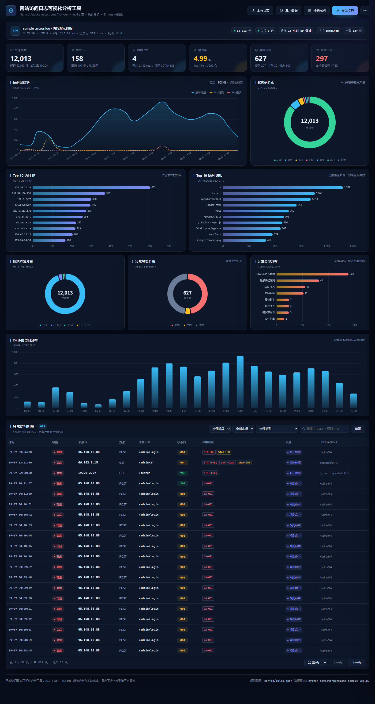

# 网站访问日志可视化分析工具

> 大二项目 · Nginx / Apache 访问日志解析、统计分析与异常检测可视化平台
>
> 后端 Flask + 前端 HTML / JavaScript / ECharts，规则外置 JSON、可热加载



## 一、项目简介

Web 访问日志是安全运维最重要的数据来源之一。本项目实现一个可运行的日志分析工具：
导入 Nginx / Apache 的 **combined** 格式访问日志，自动完成 **解析 → 统计 → 异常检测 → 可视化**，
帮助使用者快速看清“网站正在发生什么”。

对照任务书要求，功能覆盖如下：

| 任务书要求 | 本项目实现 |
| --- | --- |
| 支持上传 `.log`，≥ 1 万行不卡顿 | 上传 / 拖拽 / 内置演示日志；1.2 万行全流程约 0.5 秒 |
| 正确解析 combined 字段 | `config/log_formats.json` 支持 combined、timed_combined、common，字段级容错 |
| ① 访问趋势 ② Top 10 IP ③ Top 10 URL ④ 状态码 ⑤ 请求方法 | 全部实现，另加 24 小时分布、流量、峰值 QPS |
| ① 单 IP 高频 ② 4xx/5xx 错误率 ③ 可疑 UA ④ 攻击特征请求（≥ 5 条规则） | 5 类统计检测 + 15 条签名规则，全部可在页面查看说明 |
| ECharts 图表展示、布局清晰 | 8 个 ECharts 图表 + KPI 卡片 + 深/浅色主题 + 响应式布局 |
| 异常明细导出 CSV | `/api/anomalies/export`，UTF-8 BOM，Excel 直接打开 |
| 后端 Python Flask/FastAPI | Flask 3 |
| 解析与检测模块化、规则可配置（JSON） | `analyzer/` 分层，`config/rules.json` 外置，支持热加载 |
| Git 提交 ≥ 10 次 | 提交历史见 `git log --oneline` |
| 项目报告、演示日志 | `docs/项目报告.docx`、`data/sample_access.log`（12013 行） |

## 二、快速开始（Windows + VS Code）

### 1. 用 VS Code 打开项目

```text
文件 → 打开文件夹 → 选择 web-log-analyzer
```

推荐安装扩展：Python、Python Debugger（项目已提供 `.vscode` 配置）。

### 2. 创建虚拟环境并安装依赖

在 VS Code 终端（PowerShell）中执行：

```powershell
python -m venv .venv
.\.venv\Scripts\Activate.ps1
pip install -r requirements.txt
```

> 如果提示“禁止运行脚本”，先执行：
> `Set-ExecutionPolicy -Scope CurrentUser RemoteSigned`

### 3. 启动

按 **F5** 选择「启动日志分析工具 (Flask)」，或直接运行：

```powershell
python app.py
```

浏览器打开 <http://127.0.0.1:5000>，页面会自动加载 `data/sample_access.log` 演示数据，
无需先上传即可看到完整图表。

### 4. 其他常用命令

```powershell
# 重新生成演示日志（12000+ 行，含 8 类攻击场景）
python scripts/generate_sample_log.py

# 运行 41 个单元测试
python -m unittest discover -s tests -t . -v

# 命令行分析（不启动 Web）
python scripts/analyze_cli.py data/sample_access.log --csv anomalies.csv

# 性能基准（默认 1.2 万行 + 10 万行扩展性测试）
python scripts/benchmark.py
```

## 三、目录结构

```text
web-log-analyzer/
├── app.py                      # Flask 入口、路由、CSV 导出、内存缓存
├── requirements.txt
├── README.md
├── .vscode/                    # F5 启动、测试任务、解释器设置
├── analyzer/                   # 后端核心（与 Web 层解耦，可被 CLI/测试复用）
│   ├── parser.py               # 日志解析：多格式模板、容错、时区
│   ├── stats.py                # 统计分析：趋势 / Top N / 状态码 / 方法 / 小时分布
│   ├── detector.py             # 规则引擎 + 5 类统计检测
│   ├── export.py               # CSV 导出（UTF-8 BOM、公式注入防护）
│   └── service.py              # 服务层：解析 → 统计 → 检测
├── config/
│   ├── log_formats.json        # 日志格式正则模板（可配置）
│   └── rules.json              # 15 条签名规则 + 统计阈值（可配置、可热加载）
├── templates/index.html        # 仪表盘页面
├── static/
│   ├── css/style.css           # 深/浅色主题、响应式布局
│   ├── js/dashboard.js         # ECharts 渲染、筛选、分页、详情、规则抽屉
│   └── vendor/echarts.min.js   # ECharts 5.5.1（本地化，离线可用）
├── data/sample_access.log      # 12013 行演示日志（含攻击流量）
├── scripts/
│   ├── generate_sample_log.py  # 演示日志生成器
│   ├── analyze_cli.py          # 命令行分析工具
│   └── benchmark.py            # 性能基准
├── tests/                      # 41 个单元测试
└── docs/
    ├── 项目报告.docx            # 项目报告（架构、规则、测试、总结）
    ├── 项目报告.md              # 报告 Markdown 源稿
    ├── benchmark.json          # 性能实测数据
    └── screenshots/            # 页面截图
```

## 四、使用说明

### 4.1 上传日志

- 点击右上角「上传日志」，或把 `.log` / `.txt` 文件拖到数据集信息条；
- 单文件上限 64 MB；
- 解析失败的行会统计数量并保留前 20 条样本，不会中断整批分析。

### 4.2 图表与筛选

- 8 个图表：访问趋势、状态码分布、Top 10 IP、Top 10 URL、请求方法、异常等级、异常类型、24 小时分布；
- 趋势图支持鼠标滚轮 / 底部滑块缩放；
- 异常明细表支持按 **等级 / 来源 / 类型 / 关键词** 筛选与分页，点击任意行查看完整字段和证据 JSON；
- 筛选条件会同步到「导出 CSV」，导出内容与当前筛选一致；
- 支持 URL 预置筛选条件，例如 `/?source=statistic&level=high`；
- 深色 / 浅色主题可切换，选择保存在浏览器 localStorage。

### 4.3 检测规则

点击右上角「检测规则」打开规则抽屉，可查看：

- 15 条签名规则的编号、等级、说明、MITRE ATT&CK 编号；
- 5 类统计检测的全部阈值；
- 支持的 3 种日志格式。

修改 `config/rules.json` 后，点击抽屉底部「重新加载规则」即可生效（无需重启 Flask）。
当前数据若为内置演示数据，会自动重新分析；上传的日志需要重新上传一次。

## 五、接口说明

| 方法 | 路径 | 说明 |
| --- | --- | --- |
| GET | `/` | 可视化仪表盘页面 |
| GET | `/api/health` | 健康检查、演示日志是否存在 |
| POST | `/api/upload` | 上传日志（multipart 字段名 `file`），解析并缓存结果 |
| POST | `/api/demo` | 重新分析内置演示日志 |
| GET | `/api/stats` | 返回数据集元信息 + 全部统计数据 |
| GET | `/api/anomalies` | 异常明细，支持 `level`、`source`、`category`、`keyword`、`page`、`page_size` |
| GET | `/api/anomalies/export` | 按当前筛选条件导出 CSV（UTF-8 BOM） |
| GET | `/api/rules` | 返回规则、阈值、分类、日志格式配置 |
| POST | `/api/rules/reload` | 从磁盘热加载 `config/rules.json` |

示例：

```powershell
curl.exe "http://127.0.0.1:5000/api/stats"
curl.exe -F "file=@data/sample_access.log" "http://127.0.0.1:5000/api/upload"
curl.exe -o anomalies.csv "http://127.0.0.1:5000/api/anomalies/export?level=high"
```

## 六、检测能力

### 6.1 签名规则（15 条，节选）

| 编号 | 规则 | 等级 | 说明 |
| --- | --- | --- | --- |
| SQLI-001 | SQL 注入：联合查询 | 高 | `union select`，兼容 `/**/`、`+`、`UNION ALL` 变形 |
| SQLI-002 | SQL 注入：恒真条件 | 高 | `or 1=1` / `'1'='1` 绕过登录 |
| SQLI-003 | SQL 注入：引号闭合 | 中 | `%27` 或单引号后接 `or/and` |
| SQLI-004 | SQL 注入：时间盲注 | 高 | `sleep()` / `benchmark()` 等延时函数 |
| SQLI-005 | SQL 注入：元数据探测 | 高 | `information_schema`、`load_file()` |
| TRAV-001/002 | 路径遍历 | 高 | `../` 编码变体、`/etc/passwd`、`win.ini` |
| SENS-001 | 敏感路径探测 | 中 | `.git/`、`.env`、`phpmyadmin`、备份文件等 |
| CMDI-001 | 命令注入 | 高 | `;cat`、`\|whoami`、反引号命令替换 |
| XSS-001 | 跨站脚本 | 中 | `<script>`、`onerror=`、`javascript:` |
| LFI-001 | 文件包含 | 高 | `php://filter`、`file://` |
| SHELL-001 | WebShell 探测 | 高 | `/shell.php`、`/c99.php` 等后门路径 |
| UA-001/002/003 | 可疑 / 脚本 / 空 User-Agent | 高/低/中 | 工具 UA、脚本 UA、空 UA 分级处置 |

### 6.2 统计检测（5 类）

| 检测 | 默认阈值 | 说明 |
| --- | --- | --- |
| 单 IP 高频访问 | 60 次/分钟 | 滑动窗口计算任意 60 秒内的峰值请求数 |
| 错误率异常 | 请求 ≥ 30 且 4xx/5xx ≥ 60% | 识别扫描、爆破产生的错误洪流 |
| 目录 / 漏洞扫描 | ≥ 25 个不同 404 路径且 404 ≥ 30 次 | 结合“单条看特征、批量看统计” |
| 暴力破解 | 15 分钟内登录失败 ≥ 8 次 | 失败后出现 200 会标注“疑似爆破成功” |
| 5xx 突增 | 单分钟 ≥ 20 次 5xx | 发现后端故障或攻击打挂服务 |

> 同一 IP 的多项统计发现会合并为一条“统计检测”告警，避免页面被重复信息淹没。

## 七、演示数据

`data/sample_access.log` 共 **12013 行**，由 `scripts/generate_sample_log.py` 以固定随机种子生成，
包含 24 小时正常访问（150 个 IP、8 类浏览器 / 爬虫 UA、日间高峰分布）与 8 类攻击场景：

| 场景 | 来源 IP | 规模 | 期望检测结果 |
| --- | --- | --- | --- |
| sqlmap 注入 | 203.0.113.99 | 14 条 | SQLI-001/002/003/004/005、UA-001 |
| 路径遍历 | 198.51.100.23 | 8 条 | TRAV-001/002 |
| dirsearch 目录扫描 | 66.102.9.15 | 222 条 404 | STAT-FREQ、STAT-SCAN、STAT-ERR |
| Hydra 登录爆破 | 45.148.10.88 | 41 次 401 + 1 次 200 | STAT-BF（疑似成功）、STAT-ERR |
| XSS / 命令注入 / 文件包含 | 185.220.101.7 | 12 条 | XSS-001、CMDI-001、LFI-001、SHELL-001 |
| 空 UA 后门探测 | 91.240.118.22 | 25 条 | UA-003、SENS-001 |
| python-requests 高频抓取 | 192.0.2.77 | 300 条 | STAT-FREQ、UA-002 |
| 支付接口 5xx 突增 | 198.51.100.88 | 90 条 500 | STAT-ERR、STAT-5XX |

## 八、测试与性能

```text
Ran 41 tests in 1.541s
OK
```

| 指标 | 演示日志（12013 行） | 合成大日志（99982 行） |
| --- | --- | --- |
| 解析 | 233.8 ms | 2102.2 ms |
| 统计 | 80.8 ms | — |
| 异常检测 | 218.7 ms | — |
| 全流程 | **511.6 ms** | **4782.8 ms** |
| 吞吐 | 23479 行/秒 | 20904 行/秒 |

> 测试环境：Windows 11 + Python 3.12 + 普通笔记本；满足任务书“≥ 1 万行不卡顿”的要求。

## 九、设计说明

1. **解析与业务解耦**：`parser → stats → detector → service` 四层，Web 路由只做参数校验与 JSON 序列化；
2. **规则外置**：签名规则、统计阈值全部在 `config/rules.json`，加载时一次性编译正则，检测循环零编译开销；
3. **容错优先**：单行解析失败只计数并保留样本，不影响整批；字节数 `-`、畸形请求行、空 UA 都有专门处理；
4. **一次解析、结果缓存**：上传时解析一次，图表接口只读内存结果，避免页面刷新重复解析；
5. **前端安全**：日志内容（攻击 payload）在写入表格 / 详情前统一 HTML 转义；CSV 导出做公式注入防护；
6. **可演示性**：内置演示日志、演示数据一键重载、规则热加载、URL 预置筛选、深浅色主题。

## 十、常见问题

**Q1：页面一直显示“数据加载失败”？**
确认 `data/sample_access.log` 存在，不存在时运行 `python scripts/generate_sample_log.py`。

**Q2：上传后提示“未能解析出有效日志行”？**
本项目解析 Nginx / Apache combined 格式（含 common、timed_combined 变体），
请先抽样确认日志行数与格式；`config/log_formats.json` 可扩展正则模板。

**Q3：端口 5000 被占用？**
设置环境变量后启动：`$env:PORT=5001; python app.py`。

**Q4：修改规则后页面没变化？**
点击「检测规则 → 重新加载规则」；上传的日志需重新上传（演示数据会自动重跑）。

**Q5：ECharts 图表不显示？**
确认 `static/vendor/echarts.min.js` 存在；页面不依赖外网 CDN，可离线演示。
