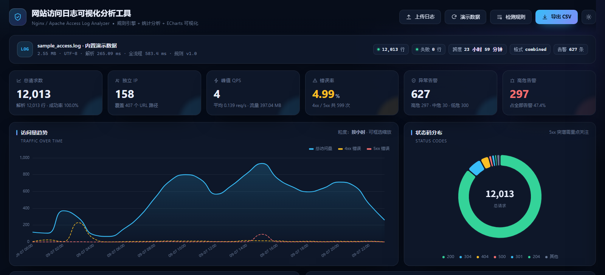
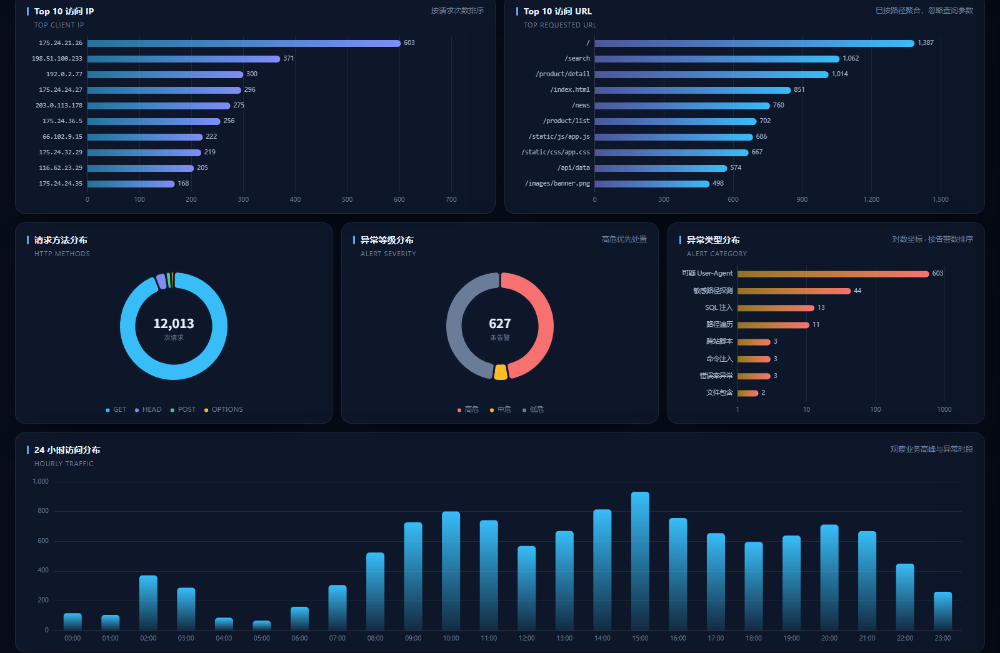
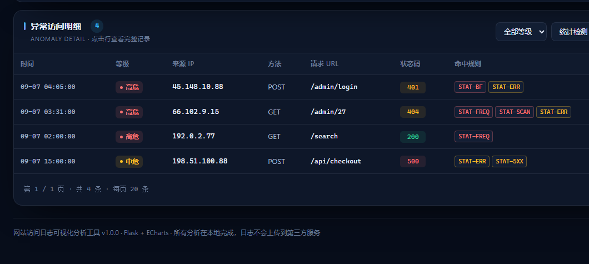
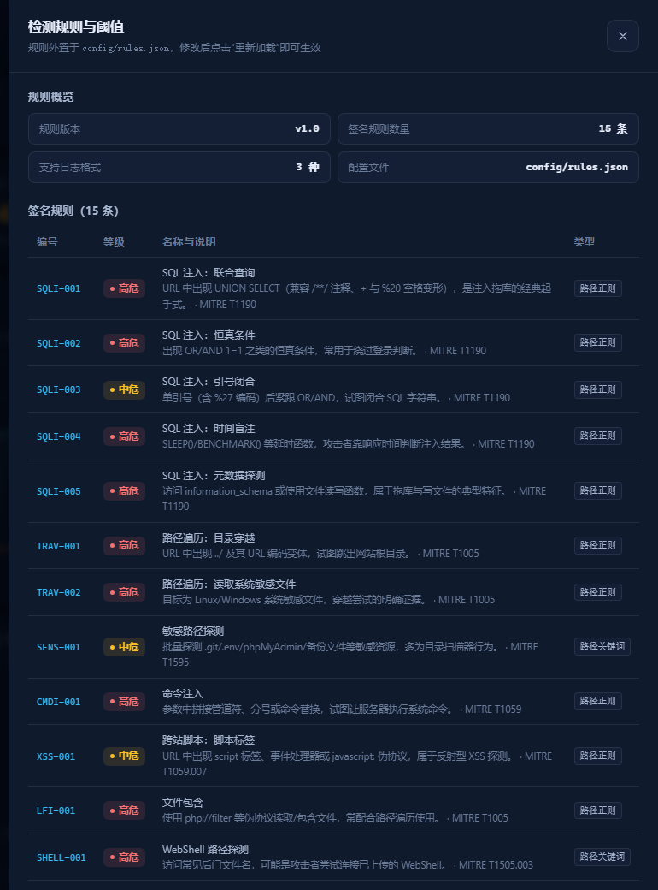
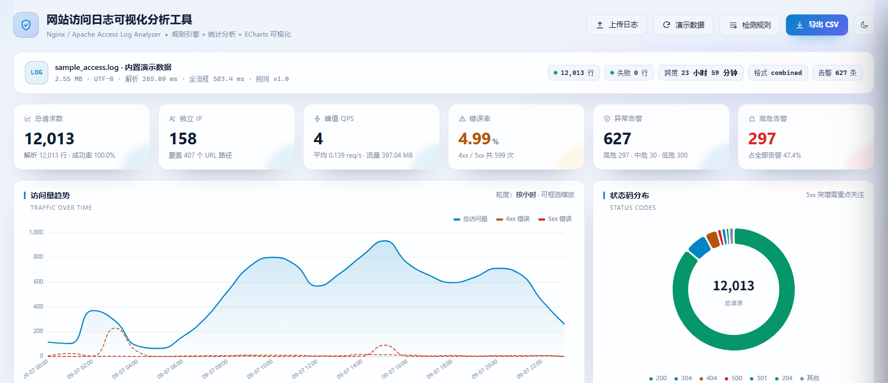

# 项目报告

## 网站访问日志可视化分析工具开发

姓　　名：songhongyi

学　　号：　　　　　　　　

班　　级：　　　　　　　　

项目周期：2 周（10 个工作日）

完成日期：2026 年 11 月 24 日

# 摘要

Web 访问日志是网站安全运维中最基础的数据来源，扫描、暴力破解、SQL 注入等攻击行为都会在日志中留下痕迹。本项目开发了一个可运行的网站访问日志可视化分析工具：以 Nginx / Apache 的 combined 格式日志为输入，自动完成日志解析、统计分析、异常检测和可视化展示。系统后端使用 Python Flask，按“解析—统计—检测”分层设计；前端使用 HTML、JavaScript 与 ECharts，提供 KPI 卡片、8 个图表、异常明细筛选与详情、CSV 导出等能力。检测部分实现了 15 条可配置签名规则和 5 类统计检测，规则与阈值全部外置于 JSON 文件并支持热加载。项目附带 12013 行含 8 类攻击场景的演示日志，全流程分析约 0.51 秒，41 个单元测试全部通过。本报告说明了需求分析、架构设计、关键实现、检测规则、测试结果与个人总结，并如实讨论了误报漏报和当前版本的局限。

**关键词**：访问日志；异常检测；规则引擎；Flask；ECharts；可视化

<!-- pagebreak -->

# 目录

- 一、项目概述
- 二、需求分析与技术方案
- 三、系统设计与实现
- 四、检测规则说明
- 五、测试与结果
- 六、演示流程与答辩准备
- 七、项目总结
- 附录 A　运行说明
- 附录 B　文件清单
- 附录 C　Git 提交记录

<!-- pagebreak -->

# 一、项目概述

## 1.1 项目背景与意义

Web 访问日志记录了每一次 HTTP 请求的客户端地址、时间、请求行、状态码、User-Agent 等关键信息。对正常业务而言，它是分析访问趋势、优化性能的依据；对安全运维而言，它是最容易获得、也最容易被忽视的证据链：攻击者的目录扫描会留下大量 404，暴力破解会留下连续的 401，SQL 注入尝试会完整地写在 URL 里，扫描器甚至会把 `sqlmap`、`dirsearch` 写进自己的 User-Agent。

问题在于日志是“给人看的一行行文本”，而不是“给机器看的结构化数据”。一份 1 万行的日志用肉眼翻看既慢又容易漏；用 `grep` 只能回答“有没有”，很难回答“什么时候、从哪来、占比多少、是否在变多”。因此需要一个工具把日志变成可交互的统计图表与可追溯的异常清单，让使用者在几分钟内看懂网站正在发生什么。

本项目正是围绕这一目标展开：不追求大而全的 SIEM 平台，而是做一个结构清晰、规则可配置、能现场演示的小型日志分析工具，把课堂上学到的 HTTP、正则、Flask、ECharts 知识串成一个完整工程。

## 1.2 项目目标与完成情况

任务书提出六项任务目标，完成情况如下表。

| 序号 | 任务书目标 | 完成情况 | 说明 |
| --- | --- | --- | --- |
| 1 | 可运行的日志分析工具，支持 Nginx / Apache 标准日志 | 已完成 | Flask 应用，支持 combined、common、timed_combined 三种格式 |
| 2 | 解析模块正确提取 IP、时间、方法、URL、状态码、UA 等字段 | 已完成 | 命名分组正则 + 字段级容错，12013 行演示日志解析成功率 100% |
| 3 | 访问量趋势、Top IP/URL、状态码、方法分布 | 已完成 | 另增加 24 小时分布、流量、峰值 QPS、独立 URL 数 |
| 4 | 基础异常检测：高频 IP、4xx/5xx、可疑 UA、可疑路径（≥5 条规则） | 已完成 | 15 条签名规则 + 5 类统计检测，规则外置可热加载 |
| 5 | ECharts 可视化（趋势、饼图/柱状图、异常明细） | 已完成 | 6 个 KPI + 8 个 ECharts 图表 + 可筛选明细表 + 详情弹窗 |
| 6 | 提交完整代码、项目报告、演示数据 | 已完成 | 源码、DOCX 报告、12013 行演示日志、41 个测试、Git 历史 14 次提交 |

## 1.3 交付物清单

| 交付物 | 位置 | 说明 |
| --- | --- | --- |
| 项目源代码 | 项目根目录 | Flask 后端、HTML/CSS/JS 前端、配置、测试、脚本 |
| 项目报告 | `docs/项目报告.docx` | 本报告，含架构、规则、测试、总结 |
| 演示日志 | `data/sample_access.log` | 12013 行，含正常流量与 8 类攻击场景 |
| 演示日志生成器 | `scripts/generate_sample_log.py` | 固定随机种子，可复现 |
| 测试用例 | `tests/` | 41 个 unittest 用例，覆盖解析、统计、检测、接口 |
| 运行说明 | `README.md` | 环境、启动、接口、规则、常见问题 |
| 页面截图 | `docs/screenshots/` | 深色、浅色、规则抽屉、统计检测明细 |
| Git 仓库 | `.git/` | 14 次提交，见附录 C |

# 二、需求分析与技术方案

## 2.1 功能需求分析

任务书的功能要求可以拆成六个模块，每个模块的落地方式如下表。

| 模块 | 任务书要求 | 本项目实现 |
| --- | --- | --- |
| 日志导入 | 上传 .log；≥1 万行不卡顿 | 页面上传 / 拖拽 / 内置演示数据；单文件上限 64 MB；上传时解析一次并缓存，后续接口只读内存 |
| 日志解析 | 正确解析 combined，字段准确 | 正则模板外置 `config/log_formats.json`，支持三种格式；解析失败只计数不中断，保留 20 条失败样本 |
| 统计分析 | 趋势、Top 10 IP、Top 10 URL、状态码、方法 | `analyzer/stats.py` 实现五类统计，另加 24 小时分布、独立 URL、流量、峰值 QPS |
| 异常检测 | 高频 IP、4xx/5xx、可疑 UA、攻击特征（≥5 条规则） | 15 条签名规则 + 5 类统计检测；同一 IP 的多项统计发现合并为一条聚合告警 |
| 可视化 | ECharts 展示全部统计与异常，布局清晰 | 8 个图表 + 6 个 KPI + 明细表；深/浅主题、响应式、图表联动筛选 |
| 结果导出 | 异常明细导出 CSV | `/api/anomalies/export`，按当前筛选条件导出，UTF-8 BOM，Excel 直接打开 |

## 2.2 非功能需求

**性能**。任务书要求 1 万行不卡顿。实现上采取三条措施：正则只在启动时编译一次；日志逐行读取，不把整份文件读进内存；上传时解析一次，统计结果缓存在进程内，图表接口不再重复解析。实测 12013 行全流程 0.51 秒，满足要求。

**容错**。真实日志里总有畸形行：请求行为 `"-"`、字节数为 `"-"`、时间格式错误、文件是 GBK 编码。解析器对每行独立处理，失败返回 `None` 并计数，绝不因为一行坏数据中断整批分析；同时保留失败样本供排查。

**可配置**。任务书明确要求“规则可配置（JSON/YAML）”。本项目把日志格式模板、15 条签名规则、全部统计阈值都外置到 `config/` 下的 JSON 文件，加载时一次性编译正则；页面提供“重新加载规则”按钮，改完 JSON 不需要重启服务、更不需要改 Python 代码。

**安全**。日志内容本身就是攻击 payload，直接拼接到 HTML 会造成存储型 XSS，因此前端所有日志字段在写入表格、详情前统一 HTML 转义；CSV 导出对以 `=`、`+`、`-`、`@` 开头的单元格加前缀单引号，防止公式注入；上传文件使用临时文件并在分析后删除，限制 64 MB。

**可演示**。演示现场不应依赖外网：ECharts 已下载到 `static/vendor/`，断网也能出图；打开页面自动加载演示日志，不需要先准备文件；规则抽屉把“规则可配置”变成看得见的界面。

## 2.3 技术选型

| 技术 | 选择 | 理由 |
| --- | --- | --- |
| 后端框架 | Flask 3 | 项目是 CPU 密集的日志解析，FastAPI 的异步优势不明显；Flask 轻量、模板渲染简单，适合两周周期 |
| 前端图表 | ECharts 5.5.1 | 折线、饼图、横向柱状图开箱即用，中文文档完善，无需构建工具 |
| 规则配置 | JSON | Python 标准库直接解析，无额外依赖；结构清晰，适合课程项目 |
| 测试框架 | unittest | 标准库自带，不引入 pytest 依赖，`python -m unittest` 即可运行 |
| 代码管理 | Git | 14 次提交，按“解析—统计—检测—接口—前端—数据—测试—文档”拆分 |

ECharts 没有使用 CDN，而是把 1 MB 的 `echarts.min.js` 放进 `static/vendor/`。这样做的好处是演示环境即使没有网络也能正常渲染；代价是仓库体积增加，但对课程项目可以接受。

## 2.4 系统架构

系统采用四层结构，Web 层只负责参数校验和 JSON 序列化，分析逻辑全部在 `analyzer/` 包内，命令行工具和单元测试可以脱离 Flask 复用同一套代码。

```text
┌──────────────────────────────────────────────────────────────┐
│ 浏览器：HTML + CSS + JavaScript + ECharts                     │
│  上传 / 筛选 / 分页 / 详情弹窗 / 规则抽屉 / 主题切换           │
└───────────────────────────┬──────────────────────────────────┘
                            │ HTTP + JSON / CSV
┌───────────────────────────▼──────────────────────────────────┐
│ Flask 应用层 app.py                                          │
│  路由、参数校验、上传临时文件、CSV 下载、内存缓存 + 线程锁      │
└───────────────────────────┬──────────────────────────────────┘
                            │
┌───────────────────────────▼──────────────────────────────────┐
│ 服务层 analyzer/service.py                                   │
│  解析 → 统计 → 检测，组装 meta / stats / anomalies            │
└───────┬───────────────────┬───────────────────┬──────────────┘
        │                   │                   │
┌───────▼──────┐   ┌────────▼───────┐   ┌───────▼──────────────┐
│ parser.py    │   │ stats.py       │   │ detector.py           │
│ 多格式正则   │   │ 趋势 / Top N   │   │ 规则引擎 + 统计检测    │
│ 字段容错     │   │ 状态码 / 方法  │   │ 告警聚合 / 分级       │
└───────┬──────┘   └────────────────┘   └───────┬──────────────┘
        │                                       │
┌───────▼───────────────────────────────────────▼──────────────┐
│ 配置层：config/log_formats.json、config/rules.json            │
│ 规则与阈值外置，加载时编译正则，支持热加载                     │
└──────────────────────────────────────────────────────────────┘
```

各模块职责：

| 模块 | 职责 | 关键设计 |
| --- | --- | --- |
| `analyzer/parser.py` | 把一行日志变成 `LogRecord` | 正则模板配置化、单行容错、保留时区、编码探测 |
| `analyzer/stats.py` | 计算趋势与分布 | 时间粒度自适应、补齐空档、路径聚合 |
| `analyzer/detector.py` | 规则匹配与统计检测 | 正则预编译、URL 解码、滑动窗口、告警合并 |
| `analyzer/service.py` | 编排一次完整分析 | 输出统一的 `meta / stats / anomalies` |
| `analyzer/export.py` | 渲染 CSV | UTF-8 BOM、公式注入防护 |
| `app.py` | Web 接口与缓存 | 单数据集缓存、线程锁、上传临时文件 |

## 2.5 数据流

1. **导入**：用户上传 `.log`，Flask 保存到临时文件；或直接加载内置演示日志。
2. **解析**：`LogParser` 依次尝试三种正则模板，把每行转成结构化记录；失败行计数并保留样本。
3. **统计**：`compute_stats` 一次遍历得到趋势、Top IP、Top URL、状态码、方法、小时分布等。
4. **检测**：`detect_anomalies` 先跑 15 条签名规则，再跑 5 类统计检测，合并同一 IP 的统计发现，按等级与时间排序。
5. **展示**：Flask 返回 JSON，前端用 ECharts 渲染；明细表按筛选条件分页请求，导出接口复用同一套过滤逻辑。

# 三、系统设计与实现

## 3.1 日志解析模块

### 3.1.1 字段与正则模板

combined 格式的一行日志包含 9～11 个字段，其中请求行、Referer、User-Agent 内部都可能含空格，绝对不能整行 `split()`。解析器使用“成对边界符”定位字段：方括号内是时间，双引号内依次是请求行、Referer、UA。

```json
{
  "name": "combined",
  "pattern": "^(?P<ip>\\S+) \\S+ \\S+ \\[(?P<time>[^\\]]+)\\] \"(?P<request>[^\"]*)\" (?P<status>\\d{3}) (?P<bytes>\\S+) \"(?P<referer>[^\"]*)\" \"(?P<ua>[^\"]*)\"\\s*$"
}
```

`LogRecord` 在原始字段之外补充了三个派生字段：`route`（去掉查询串的路径，用于 Top URL 聚合）、`real_ip`（从 X-Forwarded-For 取第一个合法地址）、`response_time`（若日志带 `rt=`）。时间使用 `%d/%b/%Y:%H:%M:%S %z` 解析，保留 `+0800` 这样的时区偏移，避免跨时区日志在趋势图上整体漂移。

### 3.1.2 单行解析与容错

核心循环如下（省略字段赋值部分）：

```python
def _parse_line(self, line):
    text = line.rstrip("\r\n")
    if not text.strip():
        return None, None
    for name, pattern in self.formats:
        match = pattern.match(text)
        if not match:
            continue
        try:
            return self._build_record(match), name
        except (ValueError, KeyError):
            # 结构匹配但时间/状态码非法，换下一个模板
            continue
    return None, None
```

所有异常都在单行范围内消化，主循环只负责计数。这样即使日志中间夹着几十行 Nginx 启动信息，也不会影响其余 1 万行的分析。

| 异常输入 | 处理方式 |
| --- | --- |
| 空行、纯空白行 | 跳过，不计入总行数 |
| 请求行整体为 `"-"` | 方法、路径、协议都记为 `"-"`，不抛异常 |
| 字节数为 `"-"`（304/HEAD/断连） | 记为 0 |
| User-Agent 为空字符串 | 保留为空，交给“空 UA”规则处理 |
| 时间为非法字符串 | 该行解析失败，换下一个格式模板 |
| 文件为 GBK / GB18030 编码 | 先读 64 KB 采样，依次尝试 UTF-8、GB18030，最后退回 latin-1 |
| 日志格式不在三种模板中 | 该行解析失败，页面显示失败行数与样本 |

### 3.1.3 性能设计

解析是整条链路里最耗时的部分，因此做了三件事：正则模块级编译一次；逐行迭代读取；编码探测只读文件头 64 KB。实测 12013 行解析 233.8 ms，约 5.1 万行/秒；10 万行解析 2102 ms。

## 3.2 统计分析模块

`compute_stats` 只遍历一次记录列表，同时累加 IP、URL、状态码、方法、小时、每秒请求数等多组计数器，避免为每个图表重复扫描。

| 统计项 | 实现方式 | 页面呈现 |
| --- | --- | --- |
| 访问量趋势 | 按分钟/小时/天分桶，补齐没有访问的时间段 | 面积折线图，含 4xx/5xx 虚线 |
| Top 10 IP | `defaultdict` 累计次数、错误数、流量，按次数降序 | 横向柱状图 |
| Top 10 URL | 先按 `route` 聚合（忽略查询参数），再排序 | 横向柱状图，标签截断 |
| 状态码分布 | Counter 统计，按百位归入 2xx/3xx/4xx/5xx | 环形饼图，中心显示总请求 |
| 请求方法 | Counter 统计 GET/POST/HEAD/OPTIONS | 环形饼图 |
| 24 小时分布 | 按小时取 24 个桶 | 柱状图 |
| 峰值 QPS | 按秒聚合后取最大值 | KPI 卡片 |
| 错误率 | `(4xx + 5xx) / 总数` | KPI 卡片，超阈值变琥珀色 |

时间粒度自适应规则：跨度不超过 6 小时按分钟，不超过 4 天按小时，否则按天；如果点数仍超过 240，则继续放大粒度。这样 1 小时的日志能看出秒级尖峰，24 小时的日志也不会因为 1440 个点而卡顿。补齐空档是为了让折线连续，否则攻击集中的时段会被压缩成一根竖线。

路径聚合是一个容易被忽略的细节：`/product/detail?id=1001` 和 `?id=1002` 如果按完整 URL 统计，会得到上千个“Top URL”，图表失去意义。因此统计用 `route`（`?` 之前的部分），检测仍用完整 `path`（注入特征往往在查询串里）。

## 3.3 规则引擎设计

### 3.3.1 规则文件结构

`config/rules.json` 包含三部分：`categories`（分类中文名）、`rules`（签名规则数组）、`thresholds`（统计检测阈值）。每条规则的字段如下：

```json
{
  "id": "SQLI-001",
  "name": "SQL 注入：联合查询",
  "category": "sql_injection",
  "type": "path_pattern",
  "pattern": "union[\\s/**/+]+(?:(?:all|distinct)[\\s/**/+]+)?select",
  "level": "high",
  "mitre": "T1190",
  "description": "URL 中出现 UNION SELECT（兼容注释符、+ 与 %20 变形）"
}
```

### 3.3.2 规则类型与匹配流程

| 类型 | 作用对象 | 匹配方式 |
| --- | --- | --- |
| `path_pattern` | URL（解码后） | 正则搜索，忽略大小写 |
| `path_keywords` | URL（解码后） | 关键词数组任一命中 |
| `ua_keywords` | User-Agent | 关键词数组任一命中 |
| `ua_empty` | User-Agent | 去空白后为空即命中 |

匹配前统一做两件事：`urllib.parse.unquote` 解码一次，然后转小写。这样 `%27`、`%20`、`UnIoN`、`/**/` 等常见变形不用为每条规则重复处理。正则编译在 `RuleEngine.__init__` 中完成，检测循环里只调用 `search`，10 万行日志也不会出现“循环里反复编译”的性能问题。

```python
def match(self, record, decoded_path=None):
    path = decoded_path if decoded_path is not None else decode_path(record.path)
    ua = (record.ua or "").lower()
    hits = []
    for rule in self.path_rules:
        if rule.type == "path_pattern" and rule.compiled.search(path):
            hits.append(rule)
        elif rule.type == "path_keywords" and any(k in path for k in rule.keywords):
            hits.append(rule)
    for rule in self.ua_rules:
        if any(k in ua for k in rule.keywords):
            hits.append(rule)
    if not ua.strip():
        hits.extend(self.empty_ua_rules)
    return hits
```

### 3.3.3 热加载

规则引擎以模块级单例缓存，避免每次请求都读文件；`POST /api/rules/reload` 从磁盘重新加载并重新编译正则。加载失败（JSON 语法错误、level 非法、正则编译失败）会返回明确的错误信息，不会把坏规则带进运行状态。页面上的“重新加载规则”按钮就是调用这个接口。

## 3.4 统计检测算法

单条日志只能提供“一次请求”，而扫描、爆破这类行为要看“一批请求”。因此除签名规则外，还实现了五类统计检测。

### 3.4.1 单 IP 高频访问

对每个 IP 的时间戳排序，用双指针维护一个 60 秒滑动窗口，求窗口内请求数的最大值：

```python
left = 0
for right, moment in enumerate(times):
    while (moment - times[left]).total_seconds() > 60:
        left += 1
    best = max(best, right - left + 1)
```

只要 `best ≥ 阈值`，就生成一条高频告警，并记录峰值、窗口起止时间和该 IP 的总请求数。阈值默认 60 次/分钟；正常业务访问 1 万行日志中单 IP 的峰值通常个位数，因此误报很低。

### 3.4.2 错误率异常

按 IP 统计总请求数和 4xx/5xx 数量，只有“总请求 ≥ 30 且错误率 ≥ 60%”才告警。要求最小请求数是为了避免“访问 2 次错 1 次”这种小样本误报。扫描器的 404 洪流、爆破的 401 洪流、5xx 故障都会触发这一类。

### 3.4.3 目录 / 漏洞扫描

同一 IP 的 404 请求数量 ≥ 30，且不同 404 路径数 ≥ 25，判定为扫描。只看 404 数量不够——普通用户输错网址也会产生 404；加上“不同路径数”才能体现“批量、自动化”的特征。告警证据中会附带 Top 5 被探测路径。

### 3.4.4 暴力破解

只统计登录类路径（`login`、`signin`、`auth`、`admin`）的 POST 请求，用滑动窗口找 15 分钟内失败（401/403/429）次数的峰值；达到 8 次即告警。如果最后一次失败之后出现 200/302，则在说明中标注“疑似爆破成功”，并把等级保持为高危——这是最需要人工介入的信号。

### 3.4.5 5xx 突增

按分钟统计 5xx 数量，单分钟 ≥ 20 次即告警，并找出该分钟错误最多的 IP 作为来源。它对应“后端故障”或“攻击把服务打挂”两种情况，和错误率异常互为补充。

| 检测项 | 关键阈值 | 主要参数 |
| --- | --- | --- |
| 单 IP 高频访问 | 60 次/分钟，且总请求 ≥ 20 | `high_freq_per_minute`、`high_freq_min_requests` |
| 错误率异常 | 总请求 ≥ 30，4xx/5xx ≥ 60% | `error_min_requests`、`error_rate_threshold` |
| 目录/漏洞扫描 | 404 ≥ 30 次，不同路径 ≥ 25 个 | `scan_min_404`、`scan_404_paths` |
| 暴力破解 | 15 分钟内失败 ≥ 8 次 | `bruteforce_fails`、`bruteforce_window_minutes` |
| 5xx 突增 | 单分钟 ≥ 20 次 | `server_error_burst` |

### 3.4.6 告警合并与分级

同一个 IP 往往同时触发高频、错误率、扫描三条统计规则。如果原样展示，页面会被同一 IP 的多条相似告警淹没。实现上把同一 IP 的多项统计发现合并为一条 `source = statistic` 的告警：等级取其中最高，`rules` 字段列出所有命中的检测项，`detail` 用分号连接各条说明，证据字段保留每项的原始数据。签名规则命中的记录则保持“一条请求一条告警”，因为明细需要可追溯。

告警排序规则是：等级（高→中→低）→ 统计检测优先于单条规则 → 时间倒序。这样第一页先看到的是“扫描 222 个路径”“爆破成功”这类高价值结论，再往下才是具体的注入请求。

## 3.5 Web 接口与缓存

| 方法 | 路径 | 说明 |
| --- | --- | --- |
| GET | `/` | 仪表盘页面 |
| GET | `/api/health` | 健康检查、演示日志是否存在 |
| POST | `/api/upload` | 上传日志，解析并替换当前数据集 |
| POST | `/api/demo` | 重新分析内置演示日志 |
| GET | `/api/stats` | 元信息 + 全部统计数据 |
| GET | `/api/anomalies` | 异常明细，支持等级、来源、类型、关键词、分页 |
| GET | `/api/anomalies/export` | 按当前筛选导出 CSV |
| GET | `/api/rules` | 规则、阈值、分类、日志格式 |
| POST | `/api/rules/reload` | 热加载规则 |

缓存设计很朴素但有效：进程内只保存“最近一次分析结果”，用 `threading.RLock` 保护读写；上传时在临时文件上解析，完成后把结果整体替换，最后删除临时文件。图表接口只读缓存，因此刷新页面、切换筛选不会重新解析日志。单数据集是刻意做出的简化——课程演示不需要多用户、多数据集，但这确实限制了它作为长期服务的可用性。

CSV 导出复用 API 的过滤函数，保证“页面看到什么，导出就是什么”。文件用 `utf-8-sig` 编码（带 BOM），Excel 打开中文不乱码；所有文本单元格经过公式注入检查；文件名带时间戳，避免覆盖。

## 3.6 前端可视化设计

### 3.6.1 布局与图表

页面采用 12 列栅格：顶部是品牌栏与操作区，下面是数据集信息条、6 个 KPI 卡片，再往下是 8 个图表卡片，最后是异常明细表。图表选型遵循“趋势用线、构成用环、排名用横向柱”的原则：

| 图表 | 类型 | 选型理由 |
| --- | --- | --- |
| 访问量趋势 | 面积折线 + 虚线 | 时间序列，面积强调总量，虚线区分 4xx/5xx |
| 状态码分布 | 环形饼图 | 构成比例，中心放总数，图例可滚动 |
| Top 10 IP | 横向柱状 | IP 字符串较长，横向排列不挤标签 |
| Top 10 URL | 横向柱状 | 同上，标签截断 26 字符，悬停看完整 URL |
| 请求方法 | 环形饼图 | 类别少，环形比柱状更紧凑 |
| 异常等级 | 环形饼图 | 高/中/低三级，红/黄/灰一眼可辨 |
| 异常类型 | 横向柱状（对数轴） | 类型多且长尾差异大，线性轴会让小类看不见 |
| 24 小时分布 | 柱状图 | 离散小时，柱状比折线更适合 |

异常类型图使用对数坐标是一个刻意的取舍：演示数据里“可疑 UA”603 条，而“文件包含”只有 2 条，线性坐标下小类几乎为零。对数轴让长尾类型可见，卡片右上角明确标注“对数坐标”，避免误读。

### 3.6.2 交互

- **上传 / 拖拽**：文件选择与拖放都走同一个上传函数，显示“正在解析”遮罩，成功后整体刷新。
- **筛选**：等级、来源、类型三个下拉加关键词输入，关键词 320 ms 防抖；筛选改变时回到第 1 页。
- **分页**：每页 20/50/100 条，显示“第 x / y 页 · 共 n 条”。
- **详情**：点击表格行弹出完整字段、命中规则、证据 JSON；按 Esc 或点遮罩关闭。
- **规则抽屉**：展示规则清单、阈值、支持的日志格式；底部可热加载。
- **主题**：深色/浅色切换，选择写入 localStorage；图表重新渲染时读取 CSS 变量，保证配色一致。
- **URL 参数**：`/?source=statistic&level=high` 可预置筛选，便于分享与演示；`/#rules` 直接打开规则抽屉。

### 3.6.3 视觉与响应式

深色主题以深蓝为底、青色为强调色，卡片使用半透明面板与细边框；高危用红、中危用琥珀、低危用灰，颜色与等级语义一致。浅色主题通过 CSS 变量整体切换，不需要改 JS。栅格在 1180 px 以下把图表改为整行，820 px 以下把 KPI 改为两列、隐藏非必要留白，430～600 px 宽度下仍可完整浏览（截图见 5.7 节）。

## 3.7 开发中遇到的问题与解决

| 问题 | 现象 | 原因与解决 |
| --- | --- | --- |
| 中文路径与编码 | Windows 控制台输出乱码，CSV 中文异常 | 统一 UTF-8：Python 启动设置 `PYTHONUTF8=1`，文件写入指定 `encoding="utf-8"`，日志读取做编码探测 |
| 变量名覆盖 | 生成脚本报 `PermissionError: 'C:\api'` | 函数参数 `path` 在循环里被 URL 变量覆盖，`abspath` 拼出了 `C:\api`；把循环变量改名 `url_path`，并养成“参数名不复用”的习惯 |
| 趋势图横轴重叠 | 24 个小时标签挤成一团 | 标签旋转 35°、按点数设置 `interval`，并保留 `hideOverlap` |
| 长尾类别看不见 | 异常类型柱状图只剩“可疑 UA”一根 | 改用对数坐标并在卡片上标注，兼顾可读性与真实性 |
| 时区漂移 | 凌晨攻击画到上午 | 解析时保留 `%z`，统计与展示都基于带时区的时间 |
| CSV 公式注入 | 以 `=` 开头的 UA 可能被 Excel 执行 | 单元格以 `= + - @` 开头时加单引号前缀 |
| 日志内容 XSS | 攻击 payload 里的 `<script>` 被拼进表格 | 前端统一 `escapeHtml`，详情与规则名称同样转义 |
| 误报控制 | `curl`、`python-requests` 命中率过高 | 把脚本类 UA 降为低危，仅作提示；统计检测叠加最小请求数阈值 |

# 四、检测规则说明

## 4.1 签名规则清单

项目共 15 条签名规则，覆盖 SQL 注入、路径遍历、敏感路径、命令注入、XSS、文件包含、WebShell、可疑 UA 八类。等级分为高/中/低：高危需要立即人工核查，中危列入观察，低危仅记录。

| 编号 | 规则名称 | 类型 | 等级 | MITRE | 检测内容 |
| --- | --- | --- | --- | --- | --- |
| SQLI-001 | SQL 注入：联合查询 | 路径正则 | 高 | T1190 | `union select`，兼容 `/**/`、`+`、`UNION ALL` |
| SQLI-002 | SQL 注入：恒真条件 | 路径正则 | 高 | T1190 | `or 1=1`、`'1'='1'` 等恒真条件 |
| SQLI-003 | SQL 注入：引号闭合 | 路径正则 | 中 | T1190 | `%27` 或单引号后跟 `or/and` |
| SQLI-004 | SQL 注入：时间盲注 | 路径正则 | 高 | T1190 | `sleep()`、`benchmark()`、`pg_sleep()` |
| SQLI-005 | SQL 注入：元数据探测 | 路径正则 | 高 | T1190 | `information_schema`、`load_file()`、`into outfile` |
| TRAV-001 | 路径遍历：目录穿越 | 路径正则 | 高 | T1005 | `../` 及 `%2e%2e%2f`、`..%5c` 等编码变体 |
| TRAV-002 | 路径遍历：敏感文件 | 路径正则 | 高 | T1005 | `/etc/passwd`、`win.ini`、`proc/self/environ` |
| SENS-001 | 敏感路径探测 | 路径关键词 | 中 | T1595 | `.git/`、`.env`、`phpmyadmin`、备份文件等 |
| CMDI-001 | 命令注入 | 路径正则 | 高 | T1059 | `;cat`、`\|whoami`、反引号命令替换 |
| XSS-001 | 跨站脚本 | 路径正则 | 中 | T1059.007 | `<script>`、`onerror=`、`javascript:` |
| LFI-001 | 文件包含 | 路径正则 | 高 | T1005 | `php://filter`、`file://`、`data:text/html` |
| SHELL-001 | WebShell 探测 | 路径关键词 | 高 | T1505.003 | `/shell.php`、`/c99.php`、`/b374k` 等 |
| UA-001 | 攻击工具 UA | UA 关键词 | 高 | T1595 | sqlmap、hydra、dirsearch、nikto、nmap 等 |
| UA-002 | 脚本/命令行 UA | UA 关键词 | 低 | T1595 | python-requests、curl、wget、go-http-client |
| UA-003 | 空 User-Agent | 空 UA | 中 | T1595 | UA 为空字符串 |

## 4.2 统计检测与阈值

| 检测项 | 判定条件（默认） | 证据字段 | 等级 |
| --- | --- | --- | --- |
| 单 IP 高频访问 | 60 秒内 ≥ 60 次，总请求 ≥ 20 | 峰值次数、窗口起止、总请求 | 高 |
| 错误率异常 | 请求 ≥ 30，4xx/5xx 占比 ≥ 60% | 总请求、错误数、4xx/5xx、错误率 | 中 |
| 目录/漏洞扫描 | 404 ≥ 30 次，不同 404 路径 ≥ 25 | 404 次数、不同路径数、Top 5 路径 | 高 |
| 暴力破解 | 15 分钟内登录失败 ≥ 8 次 | 失败次数、窗口、是否成功、目标路径 | 高 |
| 5xx 突增 | 单分钟 5xx ≥ 20 次 | 每分钟次数、分钟、主要来源 IP | 中 |

这些阈值都在 `config/rules.json` 的 `thresholds` 中，页面规则抽屉里可直接查看，修改后热加载生效。

## 4.3 分级与处置建议

| 等级 | 典型场景 | 页面表现 | 处置建议 |
| --- | --- | --- | --- |
| 高危 | 注入特征命中、路径遍历、工具 UA、扫描、爆破成功 | 红色徽章、红色图表 | 立即核查源 IP、检查对应接口与文件是否被读写 |
| 中危 | 引号闭合、XSS 探测、空 UA、错误率异常、5xx 突增 | 琥珀色徽章 | 列入观察，结合业务确认是否为误报 |
| 低危 | curl / python-requests 等脚本 UA | 灰色徽章 | 仅记录，重点看频率与目标路径 |

## 4.4 误报与漏报分析

检测系统不可能 100% 准确，课程项目也应如实说明边界。当前版本的主要误报/漏报来源如下：

| 类型 | 场景 | 原因 | 当前缓解 |
| --- | --- | --- | --- |
| 误报 | 技术博客文章 URL 含 “union select” | 关键词恰好出现在正常内容里 | 规则等级为中/高，需结合状态码与频率人工判断 |
| 误报 | 运维用 curl 健康检查 | 脚本 UA 与攻击工具难区分 | UA-002 降为低危，只记录不告警 |
| 误报 | 用户输错网址产生少量 404 | 单个 404 不代表扫描 | 扫描检测叠加“不同路径数”和“404 次数” |
| 漏报 | `UnIoN/**/SeLeCt`、双重编码 `%252e` | 正则只做一次解码 | SQLI-001 已兼容注释符；双重编码在报告中列为局限 |
| 漏报 | POST 请求体中的注入 | 日志只记录请求行，不记录 body | 属于日志本身的盲区，需结合 WAF 或应用日志 |
| 漏报 | 低频慢速扫描（每分钟 2 次） | 低于频率阈值 | 可调低阈值，或增加“长时间跨度累计”规则 |

这些取舍是刻意的：课程演示更怕“一屏几百条误报把真告警淹没”，因此优先保证高危信号的准确率，把低危信息降级展示。

## 4.5 规则扩展示例

假设要新增“PHP 伪协议包含”的变体规则，只需在 `config/rules.json` 的 `rules` 数组里加一项，然后点“重新加载规则”：

```json
{
  "id": "LFI-002",
  "name": "文件包含：PHP filter 链",
  "category": "file_inclusion",
  "type": "path_pattern",
  "pattern": "php://filter/(convert\\.base64-encode|string\\.strip_tags)",
  "level": "high",
  "mitre": "T1005",
  "description": "利用 php://filter 读取源码的常见链式写法"
}
```

不需要改 Python、不需要重启服务；如果改错了（JSON 语法错误、level 写成 `critical`、正则编译失败），加载接口会返回错误信息，旧规则继续生效。

# 五、测试与结果

## 5.1 测试环境

| 项目 | 配置 |
| --- | --- |
| 操作系统 | Windows 11 |
| Python | 3.12（虚拟环境 `.venv`） |
| Web 框架 | Flask 3.1.3 |
| 前端 | 原生 HTML / CSS / JavaScript + ECharts 5.5.1（本地文件） |
| 浏览器 | Microsoft Edge（截图与手工验收） |
| 测试框架 | unittest（标准库） |

## 5.2 单元测试

共 41 个用例，覆盖解析、统计、检测与接口四层，执行命令：

```powershell
python -m unittest discover -s tests -t . -v
```

| 测试文件 | 用例数 | 覆盖内容 |
| --- | --- | --- |
| `tests/test_parser.py` | 10 | combined 字段、时区、查询串剥离、`-` 字节数、畸形请求行、空 UA、XFF、common 格式、非法行、混合格式计数 |
| `tests/test_stats.py` | 7 | 空数据、Top N 排序、路径聚合、状态码分类、错误率、方法/小时分布、分钟补零、峰值 QPS、单位换算 |
| `tests/test_detector.py` | 13 | 15 条规则的代表性变体、URL 编码/大小写、五类统计检测、告警字段完整性、排序规则 |
| `tests/test_api.py` | 11 | 首页、健康检查、统计、分页与筛选、规则读取/热加载、CSV 导出、上传成功/扩展名/不可解析、API 404 |

执行结果：

```text
Ran 41 tests in 1.541s
OK
```

## 5.3 接口测试

| 用例 | 请求 | 预期 | 结果 |
| --- | --- | --- | --- |
| 首页渲染 | `GET /` | 200，包含图表容器与 ECharts 引用 | 通过 |
| 健康检查 | `GET /api/health` | `ok=true`，演示日志存在 | 通过 |
| 统计数据 | `GET /api/stats` | 总请求 ≥ 10000，24 个趋势点 | 通过 |
| 分页 | `GET /api/anomalies?page=1&page_size=5` | 返回 5 条，总数与汇总一致 | 通过 |
| 等级筛选 | `GET /api/anomalies?level=high` | 所有条目 `level=high` | 通过 |
| 关键词筛选 | `GET /api/anomalies?keyword=sqlmap` | 命中 sqlmap 相关记录 | 通过 |
| 规则读取 | `GET /api/rules` | 规则数 ≥ 15，含阈值 | 通过 |
| 规则热加载 | `POST /api/rules/reload` | 返回规则数量 | 通过 |
| CSV 导出 | `GET /api/anomalies/export?level=high` | 200，`text/csv`，带 BOM | 通过 |
| 上传日志 | `POST /api/upload` | 200，解析 2 行 | 通过 |
| 非法扩展名 | `POST /api/upload`（.exe） | 400 | 通过 |
| 不可解析文件 | `POST /api/upload`（乱文本） | 422 | 通过 |

## 5.4 性能测试

使用 `scripts/benchmark.py` 对演示日志重复 3 次取中位数，并把正常流量扩展到 10 万行做扩展性测试：

| 指标 | 演示日志（12013 行） | 合成日志（99982 行） |
| --- | --- | --- |
| 文件大小 | 2.55 MB | 21.66 MB |
| 解析 | 233.8 ms | 2102.2 ms |
| 统计 | 80.8 ms | — |
| 异常检测 | 218.7 ms | — |
| 全流程 | **511.6 ms** | **4782.8 ms** |
| 吞吐 | 23479 行/秒 | 20904 行/秒 |
| 告警数 | 627 条 | 632 条 |

结论：1.2 万行全流程约 0.5 秒，远低于“不卡顿”的体感阈值；10 万行约 4.8 秒，耗时近似线性，主要花在逐行正则解析上。若继续优化，可以把“正常路径先做前缀匹配、只对可疑记录跑全部规则”作为下一步。

## 5.5 演示日志检测结果

演示日志包含 24 小时正常流量与 8 类攻击场景，实际检测结果如下。

| 场景 | 源 IP | 规模 | 实际结果 | 结论 |
| --- | --- | --- | --- | --- |
| sqlmap 注入 | 203.0.113.99 | 14 条 | 14 条高危，命中 SQLI-001×7、SQLI-002/003/004 各 3、SQLI-005×2、UA-001 | 正确 |
| 路径遍历 | 198.51.100.23 | 8 条 | 8 条高危，TRAV-001×8、TRAV-002×7 | 正确 |
| dirsearch 扫描 | 66.102.9.15 | 222 条 404 | 222 条规则告警 + 1 条聚合：60 秒内 222 次、222 个不同 404、错误率 100% | 正确 |
| Hydra 爆破 | 45.148.10.88 | 41 次 401 + 1 次 200 | 42 条规则告警 + 1 条聚合：失败 41 次、疑似爆破成功 | 正确 |
| XSS/命令注入/文件包含 | 185.220.101.7 | 12 条 | 12 条（8 高 4 中），XSS-001×3、CMDI-001×3、LFI-001×2、SHELL-001×2 | 正确 |
| 空 UA 后门探测 | 91.240.118.22 | 25 条 | 25 条中危，UA-003×25、SENS-001×14 | 正确 |
| python-requests 抓取 | 192.0.2.77 | 300 条 | 300 条低危 UA-002 + 1 条高频聚合（60 秒 61 次） | 正确 |
| 支付接口 5xx | 198.51.100.88 | 90 条 500 | 1 条中危聚合：错误率 100%、两个分钟各 45 次 5xx | 正确 |

## 5.6 总体检测结果

| 指标 | 数值 |
| --- | --- |
| 总请求数 | 12013 |
| 独立 IP | 158 |
| 独立 URL 路径 | 407 |
| 流量 | 397.04 MB |
| 时间跨度 | 23 小时 59 分钟 |
| 错误率 | 4.99% |
| 异常告警 | 627 条（高危 297、中危 30、低危 300） |

签名规则命中次数（按次数排序）：

| 规则 | 次数 | 规则 | 次数 |
| --- | --- | --- | --- |
| UA-002 脚本 UA | 300 | TRAV-001 目录穿越 | 9 |
| UA-001 攻击工具 UA | 278 | SQLI-001 联合查询 | 7 |
| SENS-001 敏感路径 | 44 | SQLI-002 恒真条件 | 3 |
| UA-003 空 UA | 25 | SQLI-004 时间盲注 | 3 |
| TRAV-002 敏感文件 | 10 | SQLI-003 引号闭合 | 3 |
| CMDI-001 命令注入 | 3 | XSS-001 跨站脚本 | 3 |
| LFI-001 文件包含 | 2 | SHELL-001 WebShell | 2 |
| SQLI-005 元数据探测 | 2 | — | — |

统计检测发现：错误率异常 3 个 IP、高频访问 2 个 IP、5xx 突增 2 个分钟、扫描 1 个 IP、暴力破解 1 个 IP。

## 5.7 页面效果



图 1 展示页面顶部：左侧为数据集与解析信息，中间 6 个 KPI（总请求、独立 IP、峰值 QPS、错误率、异常告警、高危告警），下方是访问趋势与状态码分布。趋势图上 03:00 前后的两个尖峰分别对应 SQL 注入尝试与目录扫描，15:00 的 5xx 尖峰对应支付接口故障。



图 2 展示其余统计图表。Top IP 中 66.102.9.15（扫描器）与 192.0.2.77（抓取脚本）进入前五；异常类型图采用对数坐标，让文件包含、WebShell 等小类也能显示。



图 3 是异常明细表按“统计检测”筛选后的结果：扫描、爆破、高频、5xx 四类聚合告警各自只有一条，便于快速阅读；点击行可查看证据 JSON。



图 4 是规则抽屉。规则来自 `config/rules.json`，页面只是“读配置并展示”；底部“重新加载规则”对应 `POST /api/rules/reload`。



图 5 是浅色主题。颜色通过 CSS 变量切换，图表在切换后重新渲染；在窄屏下 KPI 变为两列、图表改为整行。

## 5.8 容错与边界测试

| 用例 | 输入 | 结果 |
| --- | --- | --- |
| 空文件 | 0 字节 | 前端提示“文件为空”，不写入缓存 |
| 非 combined 文本 | 两行普通文本 | 返回 422，提示确认日志格式 |
| 混合格式 | combined + common 同行数 | 两种格式都解析，`format_usage` 分别计数 |
| 畸形请求行 | `"-"` | 解析成功，方法/路径记为 `-` |
| 字节数为 `-` | 304 响应 | 字节数记为 0 |
| 空 UA | `""` | 命中 UA-003，等级中危 |
| GB18030 日志 | 含中文 UA 的 GBK 文件 | 编码探测后正常解析 |
| 超大文件 | > 64 MB | 返回 413，提示拆分日志 |
| CSV 中文 | 导出后用 Excel 打开 | 无乱码（UTF-8 BOM） |

# 六、演示流程与答辩准备

## 6.1 10 分钟演示脚本

| 时间 | 步骤 | 讲解要点 |
| --- | --- | --- |
| 0:00–1:00 | 打开首页，展示整体布局 | 说明数据来自内置演示日志，工具定位是“看懂网站正在发生什么” |
| 1:00–2:30 | 讲数据集信息与 KPI | 12013 行、158 个 IP、错误率 4.99%、627 条告警中 297 条高危 |
| 2:30–4:30 | 讲访问趋势与状态码 | 指出 03:00 注入/扫描尖峰、15:00 5xx 尖峰；状态码以 200 为主，4xx 占约 5% |
| 4:30–6:00 | 讲 Top IP / Top URL / 24 小时分布 | 扫描器、抓取脚本进入 Top IP；Top URL 是正常业务页面 |
| 6:00–8:00 | 筛选“统计检测”，讲四类聚合告警 | 扫描 222 个 404、爆破 41 次失败后 200、高频 61 次/分钟、5xx 突增 |
| 8:00–9:00 | 打开规则抽屉，演示热加载 | 说明规则外置 JSON、改规则不改代码；现场新增一条规则并重新加载 |
| 9:00–9:30 | 导出 CSV | 按筛选条件导出，Excel 直接打开 |
| 9:30–10:00 | 上传一份新日志（可选） | 说明上传、缓存、失败行提示 |

## 6.2 常见问题与回答

**Q1：为什么不用 pandas？**
日志是逐行文本，正则解析本身就是逐行操作；用标准库可以少一个依赖，也更容易讲清“逐行读取、内存恒定”。数据量再大时可以换 pandas 或流式聚合，但当前 1～10 万行不需要。

**Q2：规则为什么放在 JSON 而不是数据库？**
课程项目强调“可配置、可解释”：JSON 能直接 diff、能作为交付物阅读，加载时编译一次即可。生产环境若有几百条规则和多人维护，才需要数据库与版本管理。

**Q3：高频阈值 60 次/分钟会不会误报？**
正常用户极少在一分钟内请求同一站点 60 次；如果业务有轮询接口，可以把该路径加入白名单或调高阈值。阈值放在 JSON 里，现场就能改。

**Q4：为什么扫描检测要“不同路径数”？**
单个 404 可能是用户输错网址，扫描的本质是批量、自动化；不同路径数能区分“反复刷新一个错误页”和“按字典遍历”。

**Q5：误报怎么办？**
当前用“等级 + 阈值 + 最小请求数”控制：脚本 UA 降为低危，扫描要求 404 次数与路径数同时达标。后续可以加白名单和人工标记反馈。

**Q6：这个工具能直接上生产吗？**
不能，也没打算。它缺多用户、权限、持久化、实时流处理；但分析内核、规则引擎和前端交互是可以复用的，报告 7.3 节列了改进方向。

# 七、项目总结

## 7.1 完成情况

对照任务书，六项任务目标全部完成：工具可运行、解析字段准确、五类统计齐全、异常检测覆盖四类要求且规则达到 15 条、ECharts 图表完整、交付物齐备。额外完成了深/浅主题、URL 预置筛选、规则热加载、命令行工具和性能基准，超出了任务书的最低要求。

## 7.2 个人收获

这次项目最大的收获不是“多写了几个页面”，而是把零散的知识串成了一条工程链路。以前学正则只是做字符串练习，这次要处理引号内的空格、`%27` 编码、`/**/` 注释绕过，才真正理解“字段边界”为什么重要；以前用 ECharts 只是照着示例改配置，这次要考虑 24 个小时标签怎么不重叠、长尾类别怎么不被大柱淹没、深色和浅色主题下颜色怎么统一。

第二个收获是模块化的价值。把解析、统计、检测拆成三个模块后，单元测试可以分别构造数据，不用启动 Flask；命令行工具和 Web 接口复用同一套 `analyze_file`，改一处两边都生效。规则外置到 JSON 之后，新增一条注入规则只需要改配置，演示时现场加规则也很有说服力。

第三个收获是安全思维的转变。以前觉得“日志是可信数据”，这次意识到日志里全是攻击者可控的内容：UA 里可以写 `<script>`，URL 里可以写公式，CSV 导出后可能在 Excel 里执行。给所有输出做转义、给 CSV 做公式注入防护，这些细节比多画一个图表更能体现“安全专业”的意识。

最后是对“检测”的理解。规则不是越多越好：`curl` 规则命中率极高，如果都报高危，真正的注入告警会被淹没；扫描不能只看 404，要看“不同路径 + 频率”；爆破最危险的信号不是失败次数，而是失败之后出现的那个 200。这些判断需要在误报和漏报之间做取舍，也需要在报告里如实说明局限。

## 7.3 不足与改进方向

1. **单数据集、内存缓存**：只保留最近一次分析结果，重启即丢失，也不能同时对比多份日志。可以引入 SQLite 保存分析结果与告警，支持历史对比。
2. **全量解析、非流式**：10 万行约 4.8 秒，百万行会明显变慢。可以改成生成器 + 分块聚合，或把解析结果落到临时文件/数据库。
3. **规则覆盖有限**：目前 15 条规则，未覆盖 SSRF、反序列化、WebShell 上传后的 POST 行为；POST body 也不可见。可以接入 WAF 日志或应用日志做关联。
4. **误报反馈缺失**：页面不能标记“误报/已处理”，规则也不会根据反馈自动调整。可以加告警状态、白名单和规则命中统计。
5. **前端工程化不足**：单文件 JS、无构建、无前端测试；图表配置与业务逻辑耦合在一个文件里。后续可拆模块、引入 Vite 与 Playwright。
6. **缺少认证与部署**：当前只监听 `127.0.0.1`，没有登录与权限；如需多人使用，要加认证、CSRF、反向代理与限流。

## 7.4 参考资料

1. Nginx 官方文档：ngx_http_log_module，https://nginx.org/en/docs/http/ngx_http_log_module.html
2. Apache 官方文档：mod_log_config，https://httpd.apache.org/docs/2.4/mod/mod_log_config.html
3. Flask 官方文档，https://flask.palletsprojects.com/
4. ECharts 官方文档，https://echarts.apache.org/
5. OWASP Web Security Testing Guide，https://owasp.org/www-project-web-security-testing-guide/
6. MITRE ATT&CK，https://attack.mitre.org/
7. Python 正则表达式文档，https://docs.python.org/zh-cn/3/library/re.html
8. 课程讲义：01 HTTP 协议基础、02 Nginx 与 Apache 日志格式详解、03 Python 速成、04 ECharts 进阶、05 攻击日志特征库

<!-- pagebreak -->

# 附录 A　运行说明

```powershell
# 1. 创建虚拟环境
python -m venv .venv

# 2. 激活（PowerShell）
.\.venv\Scripts\Activate.ps1

# 3. 安装依赖
pip install -r requirements.txt

# 4. 启动
python app.py

# 5. 浏览器访问
# http://127.0.0.1:5000

# 其他命令
python scripts/generate_sample_log.py
python scripts/analyze_cli.py data/sample_access.log --csv anomalies.csv
python -m unittest discover -s tests -t . -v
python scripts/benchmark.py
```

在 VS Code 中按 F5 选择「启动日志分析工具 (Flask)」即可调试；`.vscode/tasks.json` 还提供测试、生成日志、性能基准三个任务。

# 附录 B　文件清单

| 路径 | 说明 |
| --- | --- |
| `app.py` | Flask 入口与全部接口 |
| `analyzer/parser.py` | 日志解析 |
| `analyzer/stats.py` | 统计分析 |
| `analyzer/detector.py` | 规则引擎与统计检测 |
| `analyzer/service.py` | 服务层编排 |
| `analyzer/export.py` | CSV 导出 |
| `config/log_formats.json` | 三种日志格式正则 |
| `config/rules.json` | 15 条规则与阈值 |
| `templates/index.html` | 仪表盘页面 |
| `static/css/style.css` | 主题与响应式样式 |
| `static/js/dashboard.js` | 图表与交互逻辑 |
| `static/vendor/echarts.min.js` | ECharts 5.5.1 本地文件 |
| `data/sample_access.log` | 12013 行演示日志 |
| `scripts/generate_sample_log.py` | 演示日志生成器 |
| `scripts/analyze_cli.py` | 命令行分析工具 |
| `scripts/benchmark.py` | 性能基准 |
| `tests/` | 41 个单元测试 |
| `docs/` | 报告、截图、性能数据 |

# 附录 C　Git 提交记录

项目使用 Git 管理，共 14 次提交（最后一条为报告与截图）：

| 序号 | 提交说明 |
| --- | --- |
| 1 | chore: 初始化项目结构与依赖配置 |
| 2 | feat(parser): 实现 combined 日志解析与多格式模板 |
| 3 | feat(stats): 实现访问趋势与五类统计分析 |
| 4 | feat(detector): 外置规则引擎与五类统计异常检测 |
| 5 | feat(service): 串接分析流程并实现 CSV 导出 |
| 6 | feat(api): 实现 Flask 上传、统计、异常与规则接口 |
| 7 | feat(web): 搭建 ECharts 仪表盘布局与主题样式 |
| 8 | feat(web): 实现图表渲染、筛选分页与规则抽屉 |
| 9 | feat(data): 生成含 8 类攻击场景的演示日志 |
| 10 | feat(cli): 增加命令行分析工具与性能基准 |
| 11 | test: 补充解析、统计、检测与接口单元测试 |
| 12 | docs: 编写 README 与运行说明 |
| 13 | chore: 添加 VS Code 调试与任务配置 |
| 14 | docs: 添加项目报告与演示截图 |

提交粒度按“一个可独立说明的改动”拆分，便于回看每一步做了什么；`git log --oneline` 可直接查看完整历史。
